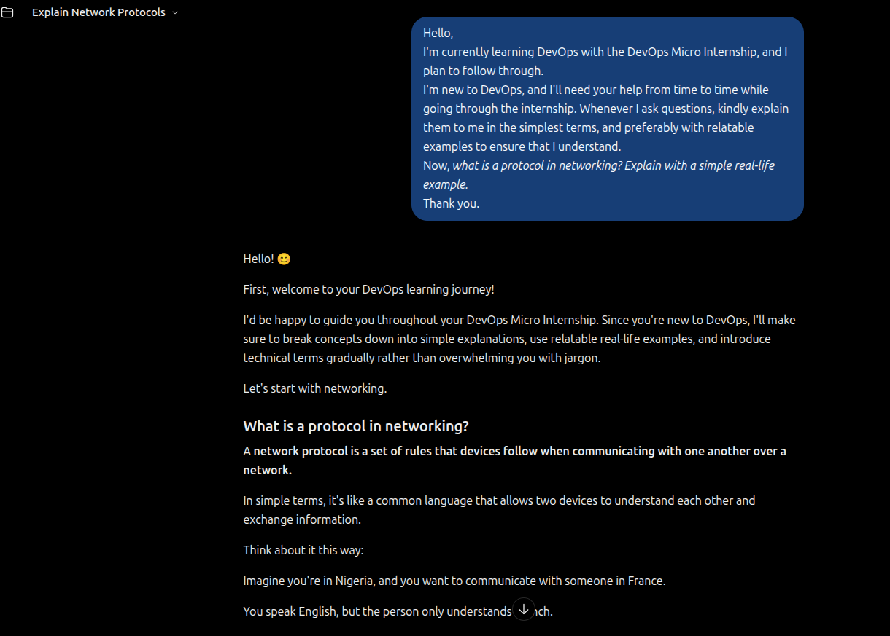
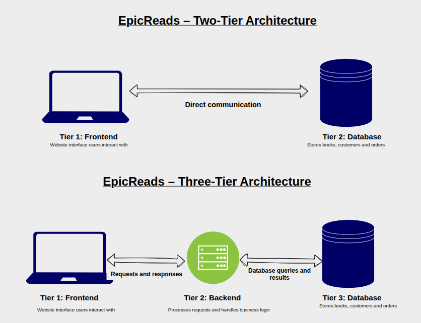
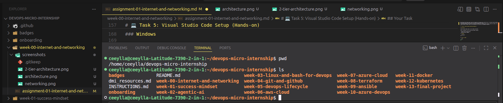

# Week 00 - Internet and Networking

Part of the DevOps Micro Internship (DMI) with Agentic AI

---

# 🧑‍💻 Task 1: Using ChatGPT as Your Learning Assistant

## Scenario

You're new to DevOps and will frequently encounter technical questions. ChatGPT can be your learning companion.

## Your Task

Write a clear ChatGPT prompt to help you understand:

> "What is a protocol in networking? Explain with a simple real-life example."

Take a screenshot of your interaction showing:

* Your detailed prompt (with clear expectations)
* ChatGPT's simplified response with an example

## Screenshot



---

## What I Learned (2–3 lines)

Protocol in networking simply refers to the set of rules that allows two devices to understand each other and exchange information.
These rules determine things like:
- How information should be sent
- How informatio should be received
- How devices identify each other
- What happens when information gets lost
- How devices know they've successful communicated.
* Networking Protocols
1. HTTP (Hypertext Transfer Protocol): Used for communication between web browsers and web servers.
2. HTTPS (HTTP Secure): Similar to HTTP, but encrypts communication to protect information.
3. TCP (Transmission Control Protocol): Ensures data is delivered reliably and in the correct order.
4. UDP (User Datagram Protocol): Sends data quickly without guaranteeing that every piece arrives.
5. SSH (Secure Shell): Allows you to securely access and control another computer remotely.

---

# 🌐 Task 2: Internet and Networking

## Scenario

Your friend is launching an online bookstore named **EpicReads**.

He asked you to explain how users globally can access his website hosted in Finland.

## Your Task

Write a short explanation (**100–150 words**) that includes:

* Packet Switching
* IP Address
* TCP/IP
* HTTP/HTTPS

## Answer

When users visits the website "EpicReads", their devices communicates with the website's server hosted in finland through the internet.
Their request is broken into smaller pieces of data called "Packets" through a process known as "Packet Switching".
These packets travel independently across different networks and are reassembled when they reach their destination.
The user's device uses an "IP address" to identify the destination server hosting EpicReads.
"TCP/IP" protocols make this communication possible. IP handles addressing and routing packets, while TCP ensures they arrive reliably and in the correct order.
HTTP/HTTPS is what allows the users browsers and EpicReads server exchange website information. HTTPS provides encryption, helping protect user's information while they browse, create accounts, and purchase books.

---

# 🏗️ Task 3: Application Architecture & Stack

## Scenario

EpicReads bookstore has two application versions:

### Two-Tier Application

* Frontend
* Database

### Three-Tier Application

* Frontend
* Backend
* Database

## Your Task

* Draw simple diagrams (hand-drawn or tool-based such as draw.io)
* Label each layer clearly
* List at least two common technologies or tools used for each layer
* Submit a screenshot or photo clearly showing your own drawing

## Diagram Screenshot / Photo

Save your diagram image in the `screenshots` folder and update the file name below.




---

## Technologies Used

### Frontend

* HTML
* CSS

### Backend

* Node.js
* Python (Django)

### Database

* MySQL
* MongoDB

---

# 🌍 Task 4: Domain Name & DNS (Basic Concepts)

## Scenario

Your friend's bookstore **EpicReads** is currently accessible through:

```text
52.172.142.222:3000
```

He purchased the domain:

```text
epicreads.com
```

## Your Task

In **50–100 words**, explain in your own words:

1. What is DNS (Domain Name System)?
2. Which DNS record type should be used to connect the domain to the given IP, and why?

## Answer

---
DNS (Domain Name System) helps find the IP addresses associated with a domain name. It translates human-readable domain names into IP addresses that the internet use to locate servers.
To connect EpicReads to its server at 52.172.142.222:3000, an A record (Address Record) should be created. An A record connects a domain name to an IPv4 address as in the case of EpicReads IP address.

---

# 💻 Task 5: Visual Studio Code Setup (Hands-on)

## Your Task

Install Visual Studio Code (if not already installed).

Take a screenshot of your VS Code environment showing:

* Terminal open inside VS Code
* Running a basic command:

### Windows

```powershell
dir
```

### Linux / macOS

```bash
pwd
ls
```

* Your selected VS Code theme clearly visible

⚠️ **Important:** The screenshot must show your username or another identifiable detail to confirm it is your environment.

## Screenshot

Save your screenshot in the `screenshots` folder and update the file name below.



---

# 🔗 Task 6: Publish Your Assignment as a LinkedIn Post

## Objective

Publishing on LinkedIn helps you:

* Build your professional online presence
* Reinforce your learning
* Document your DevOps journey publicly

## Your Task

Summarize your answers from Tasks 1–5 into a LinkedIn post.

Clearly structure your post into the following sections:

* ChatGPT
* Internet & Networking
* App Architecture
* DNS
* VS Code Setup

Use the credit note that matches your track:

Add the following credit note at the end of your post **(If you are DMI Cohort 3 student)**:

> **P.S. This post is part of the DevOps Micro Internship (DMI) with Agentic AI — Cohort 3 — by Pravin Mishra. My graded progress is public: https://dmi.pravinmishra.com/s/YOUR-GITHUB-USERNAME.html · Start your DevOps journey: https://dmi.pravinmishra.com/?utm_source=student&utm_medium=ps-linkedin&utm_campaign=cohort3**

**Tag [Pravin Mishra](https://www.linkedin.com/in/pravin-mishra-aws-trainer/) in your LinkedIn post, then tag Lead Co-Mentor — [Anjana Muthunayake](https://www.linkedin.com/in/anjana-muthunayake/).**

Add the following credit note at the end of your post **(If you are DMI Self-paced track student)**:

> **P.S. This post is part of the DevOps Micro Internship (DMI) — Self-Paced Engineer Track — by Pravin Mishra. My graded progress is public: https://dmi.pravinmishra.com/s/YOUR-GITHUB-USERNAME.html · Start your DevOps journey: https://dmi.pravinmishra.com/?utm_source=student&utm_medium=ps-linkedin&utm_campaign=self-paced**

Add the following credit note at the end of your post **(If you are DMI Campus student)**:

> **P.S. This post is part of the DevOps Micro Internship (DMI) — Campus — by Pravin Mishra. My graded progress is public: https://dmi.pravinmishra.com/s/YOUR-GITHUB-USERNAME.html · Start your DevOps journey: https://dmi.pravinmishra.com/?utm_source=student&utm_medium=ps-linkedin&utm_campaign=campus**

**Tag [Pravin Mishra](https://www.linkedin.com/in/pravin-mishra-aws-trainer/) in your LinkedIn post, then tag Lead Co-Mentor — [Anjana Muthunayake](https://www.linkedin.com/in/anjana-muthunayake/).**

Hashtags:

#DMIByPravinMishra #AgenticAI #DevOps

Replace `YOUR-GITHUB-USERNAME` with your GitHub username — that link is your public DMI progress page (your graded badge page).
---

## LinkedIn Post URL

Paste your LinkedIn post URL here:

```
https://www.linkedin.com/posts/priscilla-bertley_starting-my-devops-micro-internship-journey-share-7527769031752269824-Zz_0/
```

---

## LinkedIn Post Backup Copy

Paste the full text of your LinkedIn post here:
Starting my DevOps Micro Internship Journey! 🚀
I read a post by Salman Younas today where he shared that if he were to start learning DevOps all over again, he wouldn't start with tools. Instead, he would start with Linux and Networking.
That's exactly the approach I'm taking. Learning from the basics.
As part of the DevOps Micro Internship, organised by Pravin Mishra, I've been exploring some fundamental networking concepts. Here's a summary of what I've learnt so far:
1. ChatGPT- Network Protocols
I used ChatGPT as a learning assistant to understand what a network protocol is. I provided context and was specific with my prompts so it could explain the concept in the simplest terms.
I learnt that a network protocol is simply a set of rules that allows two devices to communicate and exchange information.
2. How data travels across the internet - Internet & Networking
Using EpicReads, a fictional online bookstore, as an example, I explored how users from different parts of the world can access a website hosted on a server in Finland.
I learnt about:
Packet Switching: How data is broken into smaller pieces called packets, which travel across networks and are reassembled at their destination.
IP Address: How devices use IP addresses to identify and locate servers.
TCP/IP: How IP handles addressing and routing, while TCP helps ensure data is delivered reliably and in the correct order.
HTTP/HTTPS: How browsers and web servers communicate to exchange website information, with HTTPS providing an additional layer of security through encryption.
3. Application Architecture
I also explored two types of application architecture:
Two-Tier Architecture: Frontend → Database.
Three-Tier Architecture: Frontend → Backend → Database.
I learnt how these layers interact and the role each plays in an application.
4. DNS (Domain Name System)
This was another interesting concept.
I learnt that DNS is like the internet's phonebook. It translates domain names into IP addresses, making it easier for users to access websites without having to memorise their IP addresses.
For example, to connect EpicReads (epicreads.com) to its server at 52.172.142.222, an A record would be created because A records map domain names to IPv4 addresses.
I also learnt that AAAA records are used for IPv6 addresses.
5. Getting familiar with the Linux terminal - Visual Studio Code Setup
I've previously installed Visual Studio Code.
I practised a couple of basic Linux commands:
pwd – Displays the current working directory.
ls – Lists the files and directories in the current directory.

P.S. This post is part of the DevOps Micro Internship (DMI) with Agentic AI — Cohort 4 — by Pravin Mishra. 
Lead Co-Mentor: Anjana Muthunayake
Start your DevOps journey: https://lnkd.in/e-iTZ4th
---

# Reflection – Week 0

### What did you find easy?

Learning how to use ChatGPT as my learning assistant.

---

### What was difficult?

The different type of DNS records and understanding the use case.

---

### What will you improve next week?

Use of ChatGPT as my learning assistant.

---

## 📌 About DMI & CloudAdvisory

DevOps Micro Internship (DMI) is a project-based DevOps program run by Pravin Mishra (The CloudAdvisory) focused on real-world execution, systems thinking, and career readiness.

It helps learners build strong DevOps foundations with hands-on experience.


## 📌 Resources

- 🌐 **DMI Official Website:** https://dmi.pravinmishra.com?utm_source=github&utm_medium=readme  
- 🎓 **University:** https://university.pravinmishra.com?utm_source=github&utm_medium=readme  
- 💬 **Discord Community:** https://discord.pravinmishra.com?utm_source=github&utm_medium=readme  
- 📝 **Blog:** https://dmi.pravinmishra.com/blog?utm_source=github&utm_medium=readme  
- ▶️ **YouTube Playlist (DMI Cohort 3):** https://www.youtube.com/playlist?list=PLFeSNDtI4Cho  
- 🔗 **Pravin Mishra (LinkedIn):** https://www.linkedin.com/in/pravin-mishra-aws-trainer/  
- 🏢 **CloudAdvisory (LinkedIn):** https://www.linkedin.com/company/thecloudadvisory/

---

*This submission is part of DevOps Micro Internship (DMI) — Agentic AI Track*